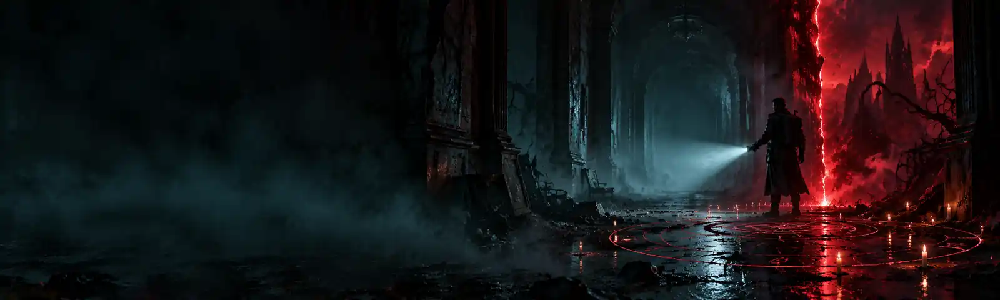

<div align="center">



# Ordem Paranormal (v2 Classic)

**Unofficial Ordem Paranormal system for Foundry VTT, with automated combat, progression, rituals and threats.**

[Português](README.md) · **English**

[](https://github.com/ogiorno/ordem-v2-classic/releases/latest)
[](https://foundryvtt.com)
[](LICENSE.txt)
[](https://github.com/ogiorno/ordem-v2-classic/releases)
[](https://github.com/ogiorno/ordem-v2-classic/issues)

[Installation](#installation) · [What's new](#what-this-fork-adds) · [Development](#development) · [Credits](#credits-and-license)

</div>

---

## About

This is a fork of [ordemparanormal_fvtt](https://github.com/SouOWendel/ordemparanormal_fvtt) by Wendel Henrique (Mark57449). It keeps the original sheets and rules and adds what a table usually does by hand: an attack dialog, death and injury, level-up, trained skills, affinity, a ritual grimoire, curses, playable threats and animations.

The core idea is **the sheet does the math and the GM decides**. The system applies bonuses, costs and conditions on its own, but flags anything that depends on a choice or on interpretation instead of resolving it silently.

> **Free and non-commercial.** Ordem Paranormal belongs to Rafael Lange (Cellbit) and Jambô Editora; this project is not affiliated with them and **does not replace the books**. See the [legal notice](#legal-notice).
>
> The system interface and compendiums are in **Portuguese (Brazil)**, with English translations available in the language settings.

## Installation

1. In Foundry, open **Game Systems → Install System**.
2. In **Manifest URL**, paste:

   ```
   https://github.com/ogiorno/ordem-v2-classic/releases/latest/download/system.json
   ```

3. Click **Install** and create a world using **Ordem Paranormal (v2 Classic)**.

**Manual install:** download `system.zip` from the [latest release](https://github.com/ogiorno/ordem-v2-classic/releases/latest) and extract it to `Data/systems/ordem_v2_classic`.

| Requirement | Details |
| --- | --- |
| Foundry VTT | v14 or newer. Tested on 14.369. |
| Required module | **Brawl Bar** (`barbrawl`), for the third token bar (HP, SAN and PE). |
| Optional | **Automated Animations** + **JB2A_DnD5e** (ritual animations). |

> **Same `id` as the original system.** The `id` is still `ordem_v2_classic`, so installing this fork over Wendel's system replaces one with the other. Back up your world before switching.

## What this fork adds

### Combat

- **Attack dialog.** Attacking opens a window listing the active "on use" options (from the weapon, items and sheet), attack and damage bonus fields, and the summed cost. **Shift+click** attacks directly.
- **Hit or Miss.** The result shows on the chat card and the player can apply the damage. The **target's Defense stays hidden** from players: they only see whether it hit.
- **GM notice.** GM-only messages show up compact and yellow, apart from the table chat.
- **Weapons with their own rules.** Chain (+2 to disarm and trip), mandatory reload for Ballista, Crossbow and Bazooka, Bazooka and Flamethrower areas, Staff, and the On Fire condition.
- **Per-turn effects.** Bleeding asks the **player** for the Vigor check (a card with a *Roll Vigor* button). The world option *Effects check at turn start* switches between **Ask the player** and **Automatic**.
- **Player death.** 0 HP makes the agent **Unconscious** and **Dying**; on the third dying turn they die. **Massive Damage** calls for Fortitude. The **Stabilize** button requires an adjacent medic. Agents only; threats work as before.
- **Damage animation.** A creature's token reacts to damage with a short effect that depends on its **primary element**, and marks Wounded and death.

### Macro bar

- **Automatic bar.** Weapons, rituals and active abilities are placed on the bar, with extra rows beyond the first. The button is in the sheet header (command `/barra`).
- **One macro per weapon.** A new weapon in an agent's inventory gets its macro automatically; a removed weapon loses it.

### Progression

- **Level-up screen.** On level-up the player sees the gains in HP, PE, PD and SAN (before → after), per-turn limits, new abilities and class benefits with "choice pending".
- **Trained skills.** The sheet keeps a training **ledger** with a slot counter. Origin, class and powers grant skills; choices are **locked to the ability** that granted them. Covers "training or +2", Eclectic, Skill Focus and Special Training.
- **Origins.** The origin sheet shows **what it grants**, and the *player* (not the GM) picks the skills. Covers all **57 origins**, including Secret Files, with a confirmation when swapping.
- **Passive powers.** Adding the power to the sheet applies the bonus; removing it takes it away. **52 powers are automatic**; the 111 that depend on a choice, a condition or the narrative stay manual and are tagged with the reason.
- **Expert.** The PE cost scales with NEX (2, 3, 4 and 5 PE; +1d6, +1d8, +1d10 and +1d12).
- **Item categories.** The Inventory tab shows `used/limit` per category, and each weapon or armor **modification** raises the item's category. The sheet only informs; the GM decides what to do when the limit is exceeded.

### Paranormal

- **Player grimoire.** A reading window for rituals, conditions and curses, with search, filters, links between terms, a condition card and "See also". Opens from a sidebar button and from the sheet.
- **Quick casting.** Cast a ritual that is already on the sheet in a few clicks, with target, range and cost checked. **Area rituals** ask you to place the area on the map **before** paying; cancelling costs nothing. The area becomes a Foundry **Region** and only **threats** inside it are affected.
- **Short ritual card.** The chat shows the result and the cost, with a link to the Grimoire.
- **Ritual animations.** The library's **98 rituals** each have a JB2A Free video, tinted by element (Blood red, Death gray, Knowledge gold, Energy blue, Fear graphite). Visual only: it does not charge, roll or deal damage.
- **Connection and affinity.** At NEX 50% the agent connects to the paranormal and picks an affinity. A sheet card shows the state. Rituals of a form that requires affinity are refused without it; tests against an effect of the element get **+1d20 or –1d20**. **29 powers** have an *Affinity* line.
- **Item curses.** A compendium with **36 curses**, a new `curse` item type, and a picker to **curse** a weapon, armor or equipment. The effect, the extra damage and the **price** to pay are applied by the system.

### Threats

- **Threat sheet in the book's format.** Challenge value, descriptors and size, Disturbing Presence, Defense, HP with *wounded*, resistances, attributes, skills and actions. In-window rolling, addable skills and a **per-test buff** (Shift+click opens the mini-menu).
- **Playable threat abilities.** More than 160 abilities with trigger, target, resistance, damage and effects configured, plus a **GM panel** to run them. Secrets (DCs, totals) are not sent to the players' chat.

### Content and quality

- Compendiums: weapons, protections, classes, paths, powers, origins, rituals, curses, threats and threat abilities, plus the content of the *Surviving the Horror* supplement.
- Support for the **Playing without Sanity** variant, which merges PE and SAN into Determination Points.
- **Portuguese and English** texts, with key checking.
- **1,536 unit tests**, plus interface tests that run inside Foundry.

## For the GM: first steps

1. Create the world and enable the **Brawl Bar** module.
2. Under **Game Settings → Configure Settings → Ordem Paranormal**, set *Effects check at turn start* to your table's style.
3. Each player creates their agent. Origin and class ask for their choices on the spot, and the skills ledger follows along.
4. To enable ritual animations, install **Automated Animations** and **JB2A_DnD5e**.
5. When something depends on interpretation, the system flags it instead of deciding. The GM has the final say.

## Work in progress

Not done yet: Multiple Professions, the Knowledge of the Monstrous option, an element chip in the inventory, a rank seal on items, and the offered price on the failed-test card. Suggestions and bugs go to the [issues](https://github.com/ogiorno/ordem-v2-classic/issues).

## Development

The repository is the development workspace; the system lives in `systems/ordem_v2_classic`.

```bash
npm install
npm run packs:pack    # compile the compendiums (packs/_source -> LevelDB)
npm test              # unit tests (no book files needed)
npm run test:livro    # checks rules against the books' text (needs the regras/ folder, which is kept out of git)
npm run lang-check    # check translation keys
npm run render-check  # check templates
npm run dev           # local Foundry server on port 30000
```

**Publishing a version:** update `version` in `systems/ordem_v2_classic/system.json` and the `CHANGELOG.md`, create the tag (`git tag -a v1.0.0 -m "..."`) and push it (`git push origin master v1.0.0`). The *Release* workflow runs the tests, builds the compendiums and publishes `system.json` and `system.zip`. The rules for AI agents working in the repository are in [`AGENTS.md`](AGENTS.md).

## Credits and license

Based on [ordemparanormal_fvtt](https://github.com/SouOWendel/ordemparanormal_fvtt) by **Wendel Henrique (Mark57449)** and contributors, modified by [ogiorno](https://github.com/ogiorno). The original project's contributor list is in [`systems/ordem_v2_classic/README.md`](systems/ordem_v2_classic/README.md).

Distributed under [CC BY-NC-SA 4.0](LICENSE.txt): you may use, copy and modify it, as long as you **give credit**, **do not use it commercially** and **keep the same license**.

### Legal notice

Ordem Paranormal was created by Rafael Lange (Cellbit) and published by Jambô Editora. This system is an **unofficial** fan work with no affiliation with the rights holders. The rights to the setting, the books and the illustrations belong to their respective owners. You need the books to play.
