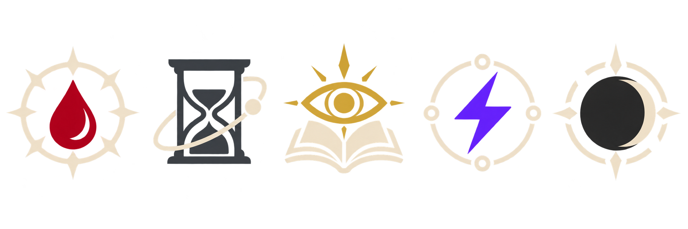

# Spec — Macro de Conjuração de Rituais

**Status:** macro implementada; seletor, custos e bloqueio por saldo verificados no mundo Foundry. A validação completa de rolagem, pagamento e efeitos ainda requer um ritual de teste.
**Sistema-alvo:** Ordem Paranormal v2 Classic no Foundry VTT.
**Referências de regras:** extração do Livro de Regras v1.3 em `D:\FTT\odem regas\06-o-outro-lado`; mapeamento técnico do sistema em [mapeamento-rituais-agente.md](mapeamento-rituais-agente.md).

## Objetivo

Criar uma macro que conduza o jogador da escolha de um ritual conhecido até a publicação do resultado no chat. Ela deve mostrar os rituais do agente ativo, permitir filtrar rituais por círculo, escolher o círculo de custo e alvo, mostrar custo e consequências antes da confirmação, consumir o recurso de esforço configurado como PD no jogo do usuário e executar os testes exigidos pelas regras. A macro não deve simular que o teste de Ocultismo de “O Custo do Paranormal” decide se o efeito acontece: esse teste mede a consequência de conjurar o ritual.

## Ajuste de UX solicitado pelo usuário

Na janela de conjuração, remover “Adicional em PD”, o seletor de formas avançadas e o limite estimado por turno. O jogador escolhe em um único seletor o círculo de custo (do círculo cadastrado no ritual até o 4º); o custo é fixo pela regra do círculo: 1º = 1 PE, 2º = 3 PE, 3º = 6 PE e 4º = 10 PE. Esse seletor define o custo escolhido; não altera o círculo original do item nem seu efeito. Aprimoramentos Discente/Verdadeiro permanecem apenas na descrição. Mostrar sempre a tabela de custos e o custo selecionado. Validar o saldo de PD disponível na ficha (o PE da mesa está fundido em PD) antes de conjurar. Consequências de Sanidade depois do teste continuam separadas do custo de conjuração.

## Sequência de trabalho exigida

1. **Validar antes de implementar:** fazer um protótipo de prova de conceito sem alterar recursos, confirmar as APIs e os campos no Foundry/system Classic, e percorrer os casos da seção “Testes de validação”. A prova de conceito deve exercitar a seleção, cálculo de custo, chamadas de rolagem e condições de bloqueio. Não deve descontar PD nem publicar resultados como se fossem conjurações reais.
2. **Implementar depois da validação:** só então escrever a macro de uso, reaproveitando os componentes e chamadas que passaram na prova. A implementação deve manter o resumo e os controles definidos nesta spec; se algum teste revelar divergência entre regra extraída e dados do sistema, atualizar esta spec antes de codificar esse comportamento.
3. **Testar a macro implementada:** repetir os casos com um agente de teste no Foundry, confirmar os valores antes/depois no recurso e conferir mensagens, cancelamento e falhas. Não declarar pronta sem esse teste de ponta a ponta.

## Regras que definem o fluxo

As regras abaixo foram conferidas nos arquivos extraídos; os caminhos são relativos a `D:\FTT\odem regas`.

| Regra | Comportamento requerido | Fonte extraída |
|---|---|---|
| Custo básico | 1º círculo = 1 PE; 2º = 3 PE; 3º = 6 PE; 4º = 10 PE. | `06-o-outro-lado/0867-rituais.md` e `0868-toque.md` |
| Formas avançadas | As regras Discente/Verdadeira continuam na descrição do ritual, mas não são escolhidas nem cobradas por esta janela. Esta versão aplica somente o custo fixo do círculo selecionado. | `06-o-outro-lado/0894-formas-avancadas.md`; ajuste de UX solicitado |
| Saldo para conjurar | Nesta UX, conferir se o saldo de PD cobre o custo do círculo selecionado. O limite estimado por turno não é mostrado nem validado pela macro. | Pedido do usuário; tabela `06-o-outro-lado/0867-rituais.md` e `0868-toque.md` |
| Recurso no jogo do usuário | O PE está representado pelo saldo **PD** desta mesa. Mostrar esse saldo, comparar com o custo fixo do círculo e debitar esse custo uma vez quando a conjuração for confirmada. | Pedido do usuário; `mapeamento-rituais-agente.md`; `module/documents/actor.mjs`; confirmado na ficha do agente no Foundry |
| Custo do Paranormal | Em ritual que não seja de Medo, fazer teste de Ocultismo contra DT 20 + custo final. A falha reduz Sanidade igual ao custo; falhar por 5 ou mais também reduz 1 SAN permanentemente. A falha **não cancela por si só** o ritual. | `06-o-outro-lado/0895-o-custo-do-paranormal.md` |
| Medo | Não pedir componente ritualístico; exigir personagem Marcado conforme regra de mesa. Ao conjurar, aplicar a perda de SAN igual ao custo e perda permanente de SAN: 1 na forma básica, 2 na Discente, 3 na Verdadeira. Não rolar o teste de Ocultismo de “O Custo do Paranormal”. | `06-o-outro-lado/0896-invocando-o-medo.md` |
| Ação e componentes | Exibir tipo de execução do ritual e alertar sobre mão livre/componentes. A macro não consegue confirmar ficcionalmente essas condições; deixar a confirmação ao jogador/Mestre. | `06-o-outro-lado/0859-acao-e-custo.md`, `0860-gestos-e-componentes.md` |
| Concentração | Se o jogador indicar condição ruim ou terrível, ou dano durante a execução, solicitar teste de Vontade com DT prevista na regra. Falha impede o efeito e o custo já gasto é perdido. | `06-o-outro-lado/0861-concentracao.md` |
| Testes do ritual | Um teste de resistência do alvo ou outro teste especificado no texto do ritual é um passo separado. A macro deve usar os campos estruturados quando representarem a regra; exceções e efeitos narrativos ficam para resolução manual do Mestre. | `06-o-outro-lado/0874-efeito.md`, `0888-resistencia.md`, descrição do ritual |

**Importante sobre a extração:** `RitualData` do Classic tem círculo, elemento e flags de formas, mas não tem um campo estruturado de custo adicional. Como esta UX não oferece formas avançadas, o custo não é inferido do texto: aplica-se apenas a tabela fixa do círculo escolhido. O seletor de círculo altera o custo pago, mas preserva o círculo original do item e o efeito descrito.

O Classic descreve a configuração “Jogando sem Sanidade” como a fusão de PE e SAN em PD. O custo de conjuração é sempre cobrado uma vez conforme o círculo escolhido. Uma perda temporária de SAN causada pelo teste é uma consequência separada da regra; a perda permanente continua explícita para ajuste manual quando não houver campo estruturado confiável.

**Resultado da verificação do sistema:** `PD.perRound` é recuperação, não saldo para pagar o ritual. A janela usa o valor atual de `actor.system.PD.value` e não calcula limite de gasto por turno.

**Correção de interpretação do mapeamento anterior:** o texto de regra v1.3 torna o teste de Ocultismo em “O Custo do Paranormal” um teste de consequência de Sanidade, não um teste geral que determina sucesso do ritual. A implementação deve preservar essa diferença. Um ritual só deixa de funcionar por falha de concentração ou por uma condição/regra específica descrita nele.

## Experiência do jogador

### 1. Abrir e identificar o agente

- Ao clicar na macro, resolver primeiro o agente do token controlado; se não houver, usar o ator/token do contexto de chat apenas quando não houver ambiguidade.
- Se nenhum agente único puder ser resolvido, mostrar uma escolha de agente ou uma instrução clara para selecionar/controlar um token. Não abrir uma lista vazia silenciosamente.
- Listar somente rituais conhecidos daquele agente. Exibir estado vazio explicando que a ficha não contém rituais.

### 2. Escolher o ritual

- Abrir uma janela em português, com busca por nome e filtros de círculo original do item: **Todos**, **1º**, **2º**, **3º**, **4º**. O círculo original permanece intacto; a escolha separada do círculo de custo não altera o efeito do item.
- Organizar os resultados por círculo. Cada cartão compacto mostra ícone, nome, círculo, afinidade, execução, alcance e custo básico. Selecionar o ritual abre o detalhe sem fechar a janela.
- Usar `item.img` quando existir um retrato apropriado. Caso contrário, usar o glifo da afinidade do protótipo visual desta spec, com o nome do ritual legível; aplicar a cor da afinidade também a um filete/etiqueta para que a cor nunca seja a única distinção.
- O jogador pode voltar à lista sem perder escolhas já válidas.

### 3. Escolher círculo e conferir custo

- Mostrar em um seletor os círculos de conjuração disponíveis, começando pelo círculo cadastrado no ritual. A escolha atualiza o custo fixo conforme a tabela oficial: 1 PE, 3 PE, 6 PE ou 10 PE.
- Não exibir campo de adicional em PD nem limite estimado por turno nesta janela. Não somar custo avançado ao custo do círculo.
- Mostrar saldo de PD disponível, custo do círculo em PE (debitado do saldo PD) e saldo estimado após o pagamento. Bloquear “Conjurar” quando o saldo não cobrir o custo ou quando requisito ritualístico obrigatório estiver pendente.
- Exibir uma caixa de confirmação curta: ritual, círculo de custo escolhido, alvo, execução, custo pago, teste de Ocultismo/SAN aplicável, e requisitos ficcionais de componentes/concentração. Nada é debitado enquanto o diálogo não for confirmado.

### 4. Alvo, área e opções do Mestre

- Preselecionar tokens que o jogador marcou como alvo quando compatíveis com o ritual. Permitir escolher um ou mais alvos se o texto/metadados pedirem isso.
- Para ritual pessoal/sem alvo, não exigir token-alvo. Para área, permitir informar o ponto/área na cena ou deixar a definição narrativa para o Mestre quando a macro não tiver integração espacial segura.
- Mostrar a resistência definida no item. A rolagem do alvo deve ser disparada como etapa própria, nunca confundida com o teste de Ocultismo do conjurador.
- Se o ritual tiver DT, teste ou regra especial apenas no texto livre, exibir a instrução do ritual no resumo e deixar o Mestre resolver manualmente; não inventar DT padrão nem aplicação automática do efeito.

### 5. Confirmar, pagar e resolver

- Na confirmação, validar novamente o saldo atualizado e debitar o custo uma vez. O pagamento segue a regra de gasto mesmo em falha, conforme `05-regras/0675-gasto-de-pe.md`. Evitar duplo débito caso o jogador clique mais de uma vez.
- Para elementos diferentes de Medo, rolar Ocultismo contra `20 + custo final`, com diálogo nativo de rolagem para permitir escolha de atributo e modificadores. Publicar resultado e consequências de SAN sem cancelar automaticamente o efeito em caso de falha. Se a mesa estiver no modo PD, tratar a perda de SAN conforme a fusão de recursos confirmada na prova.
- Para Medo, não fazer essa rolagem; apresentar e registrar as perdas de SAN temporária e permanente previstas pela regra. A perda permanente fica explícita para ajuste manual quando não houver campo estruturado confiável.
- Se houve condição de concentração, resolver teste de Vontade conforme `0861-concentracao.md`. Falha bloqueia o efeito e mantém o custo pago.
- Publicar no chat uma mensagem única com ícone/colorização, agente, ritual e círculo de custo, custo/recurso, execução, alvo(s), teste(s), DT/resultado e descrição/efeito. Anexar a carta existente do item ou um resumo fiel, sem publicar custo duas vezes.
- Cancelar em qualquer diálogo antes da confirmação não rola dados, não altera recursos e não cria mensagem de conjuração.

## Direção visual

Paleta inicial compatível com os acentos encontrados no Classic: Sangue `#b3262d`, Morte `#6b6f7a`, Conhecimento `#c98a12`, Energia `#7d3fc4` e Medo `#4a4a4a`. A prancha de referência está em [ritual-elementos.png](ritual-elementos.png). Ela representa cinco glifos-base para a afinidade; não é uma ilustração exclusiva de cada ritual. Na macro, o retrato próprio do item tem prioridade, e o glifo funciona como fallback identificável. Assim cada ritual mantém identidade pelo nome/arte do item e pela afinidade sem prometer geração de imagem dinâmica dentro do Foundry.

Os cinco glifos da imagem são, na ordem, Sangue (gota/espinho), Morte (espiral/ampulheta), Conhecimento (olho/página), Energia (raio/circuito) e Medo (eclipse/abismo). O contraste, a transparência e a leitura em miniatura devem ser verificados na janela real antes de aceitar os assets finais.

## Plano de validação antes da implementação

### Prova de conceito sem mutação

1. Abrir a macro sem token, com um token agente controlado, com ator não-agente e com mais de um agente possível; conferir seleção/erro compreensível.
2. Usar um agente com rituais de círculos diferentes; conferir busca, filtros, ordenação e metadados corretos.
3. Validar no seletor os custos 1, 3, 6 e 10 para círculos 1 a 4; confirmar que o custo muda com a escolha e que não há campo de adicional nem limite por turno.
4. Confirmar que Discente/Verdadeira ficam apenas na descrição e nunca alteram o custo calculado pela macro.
5. Conferir o método nativo de `rollSkill` com Ocultismo e Vontade no Classic, presença de DT no diálogo e leitura do resultado/cancelamento. Confirmar os nomes reais das perícias do sistema (`occultism`, `will`) e campos de resistência.
6. Confirmar a leitura do saldo PD e validar saldo zero, custo exatamente igual ao saldo e custo acima do saldo. Não há validação de limite por turno.
7. Confirmar, sem atualizar o ator, a ordem pretendida de validação, rolagem e composição da mensagem. Cancelamentos e erros não podem gravar mensagens nem recursos.
8. Conferir os cinco ícones em tamanho pequeno, transparência, cores e distinção sem depender apenas da cor.

### Testes de aceitação após implementar

- Ritual básico de Sangue: custo de círculo, confirmação, débito único e teste de Ocultismo de consequência.
- Ritual básico de Medo: sem teste de Ocultismo do custo, aviso/perda de SAN correspondente e sem componente ritualístico.
- Seletor de círculo: validar custos 1/3/6/10 PE e preservar efeito/círculo original do item.
- Falha no teste de Ocultismo: efeito permanece elegível, custo permanece pago e consequências de SAN são registradas de acordo com a diferença para a DT.
- Falha de concentração: efeito não é aplicado, custo permanece pago e chat explica a interrupção.
- Ritual com resistência estruturada: resistência do alvo acontece separadamente e usa o resultado configurado.
- Cancelar ou ficar sem saldo entre abrir e confirmar: nenhuma rolagem ou débito duplicado; erro claro.
- Sem `item.img`: fallback de afinidade correto; com `item.img`: retrato do item aparece com acento de afinidade.

## Limites de escopo da primeira versão

A primeira versão guia escolhas, paga recurso, rola testes gerais exigidos pela regra e registra resultados. Ela não interpreta linguagem natural para impor todos os efeitos, não escolhe área em grid sem validação de alcance/forma, não resolve sozinho situações narrativas, e não automatiza dano, condições ou efeitos especiais descritos apenas em texto. Isso evita que um resumo incompleto altere o efeito do ritual.

## Implementação entregue e validação restante

A implementação fica em `systems/ordem_v2_classic/module/macros/ritual-caster.mjs`, com regras puras em `ritual-caster-logic.mjs`, glifos em `systems/ordem_v2_classic/assets/ritual-elementos.png` e o Macro document em `packs/_source/macros/conjurar-ritual.json`, compilado no compêndio **Macros**. O comando avulso está em `docs/macros/conjurar-ritual.js`. A janela reúne busca, filtro pelo círculo original, seletor de custo por círculo, saldo, alvos, concentração e confirmações; o saldo só é debitado após confirmar a conjuração. Medo não rola Ocultismo e pede confirmação de personagem Marcado.

Os testes unitários validam cálculo e bloqueios sem mutar atores. No mundo Foundry, a ficha `agente` mostrou 3/5 PD: o 2º círculo exibiu custo 3 PE e saldo restante 0 PD; o 3º exibiu custo 6 PE, falta de 3 PD e bloqueou o botão mesmo com alvo e confirmação de execução preenchidos. Nenhum ritual foi executado durante essa verificação. Ainda falta validar uma conjuração completa em um agente de teste, incluindo rolagens, débito e aplicação de efeito.

## Critério de validação restante

A prova de UX do seletor, do cálculo dos custos e do bloqueio por saldo foi concluída no mundo Foundry. Para considerar a macro pronta para mesa, ainda é necessário executar um ritual de teste com consentimento da mesa e verificar, de ponta a ponta, os testes, o pagamento único, a mensagem de chat e a aplicação do efeito. Se uma regra não puder ser validada, a macro deve manter a consequência explícita para resolução manual em vez de assumir um resultado.
